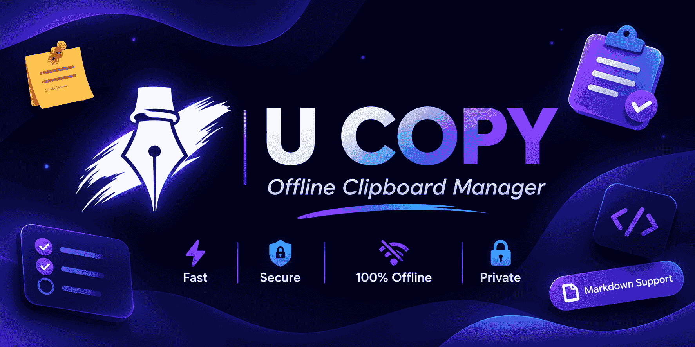
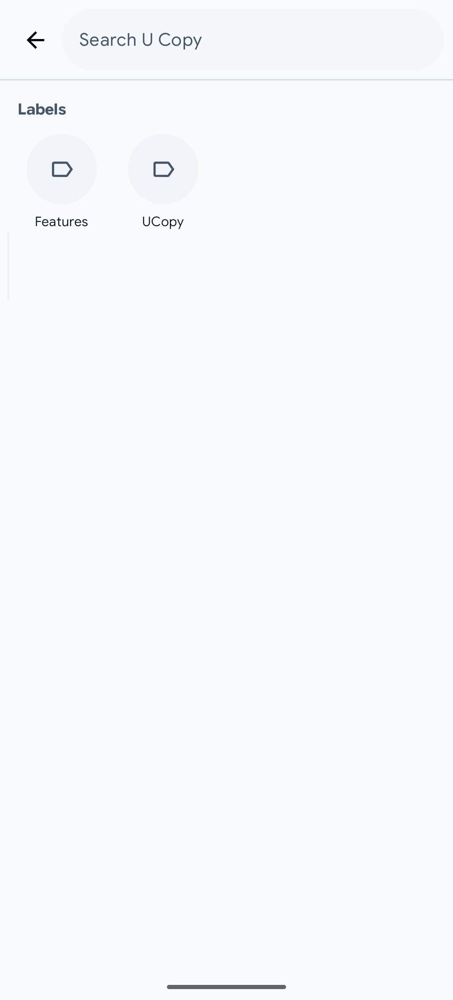
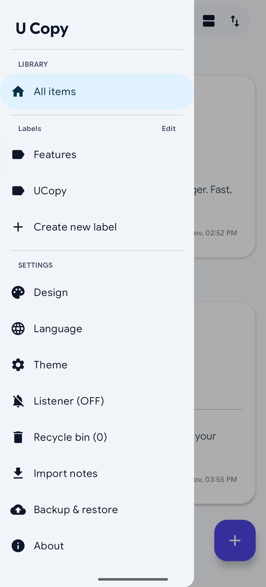
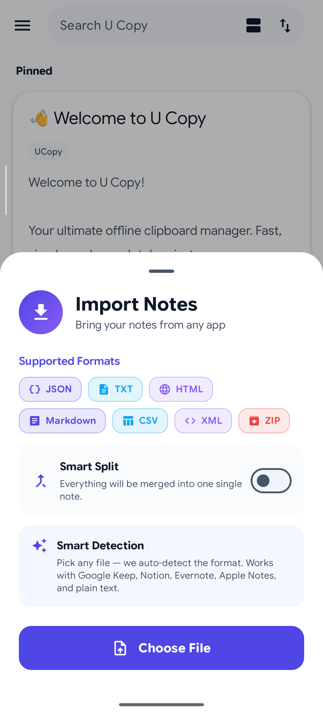
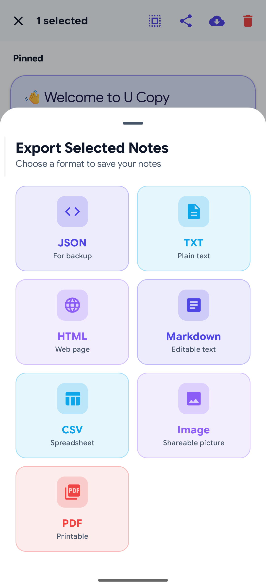
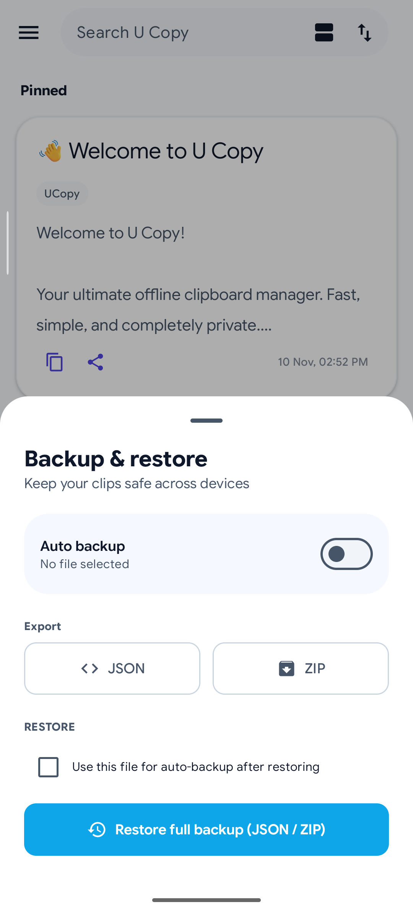
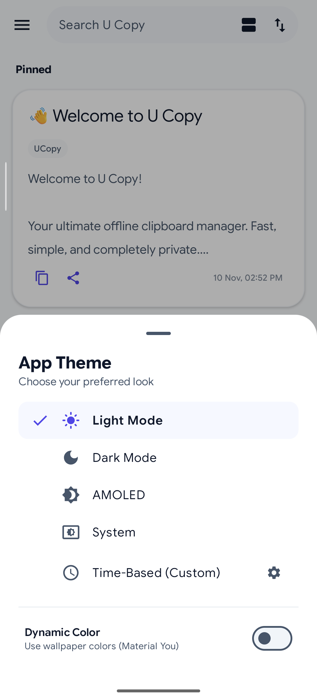
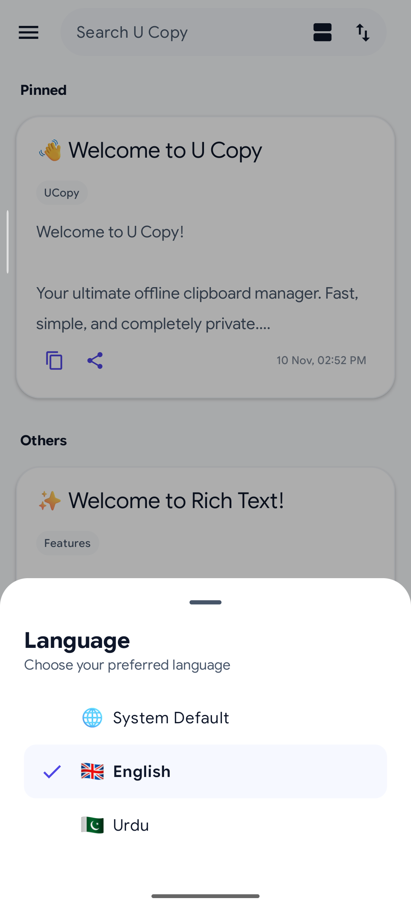
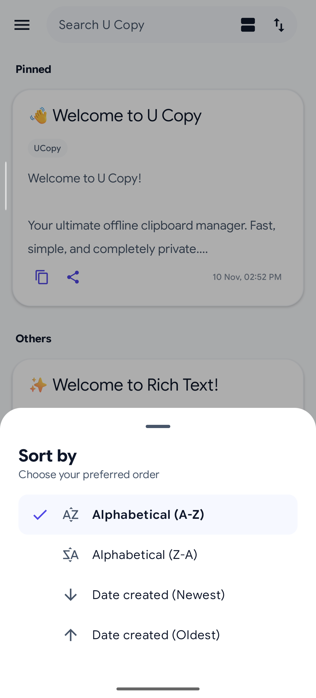
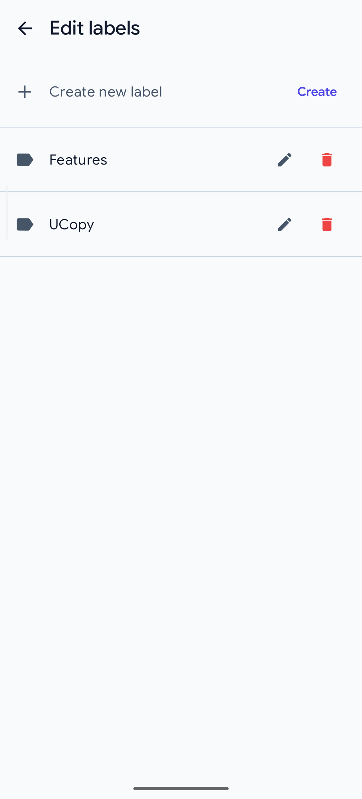

# U Copy

  
   
  
   
  

**The ultimate fast, beautiful, AI-powered, and completely private offline clipboard manager for Android.**

> ⚠️ **Note:** This project is actively maintained. If you find any bugs or have feature requests, please report them in the [Issues](https://github.com/umarninja13-pro/UCopy/issues) section.

   
  

---

## 📖 About U Copy

U Copy is designed to be your daily driver for managing notes, to-do lists, and clipboard history. Built from the ground up to be **100% Offline, Private, and Lightning Fast**. Your data never leaves your device—no servers, no tracking, no internet required.

Whether you are saving a quick link, asking the built-in **AI Co-Pilot** to organize your thoughts, drafting a long story with Markdown, or managing a to-do list via a home screen widget, U Copy provides a seamless and premium experience.

## ✨ Key Features

- 🧠 **AI Co-Pilot (Offline):** Smartly analyzes your text as you type to suggest perfect titles and labels automatically. No internet required!
- 🔒 **100% Offline & Private:** No network permissions. Your notes are securely stored in a local **Room Database**.
- 📝 **Rich Text & Markdown:** Write beautiful notes using Markdown (bold, italics, lists, code blocks) and even preview HTML.
- 🎨 **4 Unique Design Modes:** 
  - **Default:** Clean Material You aesthetic.
  - **Notebooks:** Large colorful cards for writers.
  - **Simple:** Minimal, distraction-free list (Apple Notes style).
  - **Sticky:** Playful and colorful sticky notes.
- 📱 **Smart Home Screen Widgets:** 
  - **Note Widget:** Pin any note to your home screen with live Markdown rendering.
  - **Todo Widget:** Tick off tasks directly from your home screen.
  - **Sticker Widget:** Create custom text stickers with beautiful fonts, colors, and outlines.
- 📥 **Universal Import:** Easily migrate from other apps! Import from **Google Keep, Notion, Evernote (ENEX), Apple Notes, TXT, HTML, CSV, JSON, and ZIP**.
- 📤 **Powerful Export:** Backup your data as JSON, ZIP, TXT, HTML, PDF, Markdown, CSV, or even as an **Image (PNG)**.
- 📋 **Smart Clipboard Listener:** Automatically detects when you copy text in the background and prompts you to save it.
- 🗑️ **Recycle Bin:** Accidentally deleted something? Restore it from the trash. Includes an **Auto-Delete** timer to keep things clean.
- 🌍 **Multi-Language:** Full support for **English** and **Urdu (اردو)** with RTL layout support.
- ☑️ **Interactive Checklists:** Create to-do lists with drag-and-drop reordering and auto-save.
- 🌈 **Fully Customizable:** 
  - Time-Based Themes (Auto Light/Dark based on time).
  - AMOLED Dark Mode.
  - Dynamic Color (Material You) on Android 12+.
  - 4 View Densities (Compact, Comfortable, Grid, Detailed).
- ↩️ **Undo/Redo:** Full support while editing long notes.

---

## 📸 Screenshots

### 🎨 Design Modes
<table align="center">
  <tr>
    <td align="center"> <b>Default</b></td>
    <td align="center"> <b>Notebooks</b></td>
    <td align="center"> <b>Simple</b></td>
    <td align="center"> <b>Sticky</b></td>
  </tr>
</table>

### ⚡ Core Experience
<table align="center">
  <tr>
    <td align="center"> <b>Quick Menu</b></td>
    <td align="center"> <b>Smart Search</b></td>
    <td align="center"> <b>Navigation</b></td>
    <td align="center"> <b>AMOLED Mode</b></td>
  </tr>
</table>

### 🛠️ Data Management
<table align="center">
  <tr>
    <td align="center"> <b>Import Notes</b></td>
    <td align="center"> <b>Export Options</b></td>
    <td align="center"> <b>Auto Backup</b></td>
    <td align="center"> <b>Recycle Bin</b></td>
  </tr>
</table>

### 🌈 Customization & Settings
<table align="center">
  <tr>
    <td align="center"> <b>Themes</b></td>
    <td align="center"> <b>Languages</b></td>
    <td align="center"> <b>View Density</b></td>
    <td align="center"> <b>Sorting</b></td>
  </tr>
</table>

### ✨ More Features
<table align="center">
  <tr>
    <td align="center"> <b>Clipboard Listener</b></td>
    <td align="center"> <b>Custom Labels</b></td>
    <td align="center"> <b>Design Selector</b></td>
  </tr>
</table>

---

## 🛠️ Tech Stack

- **Language:** Kotlin
- **UI Toolkit:** Jetpack Compose (Material 3)
- **Architecture:** MVVM (Model-View-ViewModel)
- **Asynchronous Programming:** Kotlin Coroutines & Flow
- **Data Persistence:** Room Database, DataStore (Preferences), Kotlinx.serialization (JSON)
- **Markdown Parsing:** Markwon
- **Build System:** Gradle (Kotlin DSL)

## 🚀 Getting Started

To build this project locally, you need Android Studio or AndroidIDE.

1. Clone the repository:
   git clone https://github.com/umarninja13-pro/UCopy.git
2. Open the project in Android Studio.
3. Sync the Gradle files.
4. Build and run on your emulator or physical device.

## 👨‍💻 Meet the Developer

**Umar Khatab**
I love building clean, fast, and offline-first Android apps. U Copy is my personal project to make clipboard and note management effortless, secure, and beautiful.

- 📧 Email: [umarninja13@gmail.com](mailto:umarninja13@gmail.com)
- 📱 Need a custom app? Reach out for a quote!

## ☕ Support Development

If you find U Copy useful and want to support its development, consider donating!

## 📄 License

This project is licensed under the Apache License 2.0. See the [LICENSE](LICENSE) file for more details.

---

Made with ❤️ by Umar Khatab

